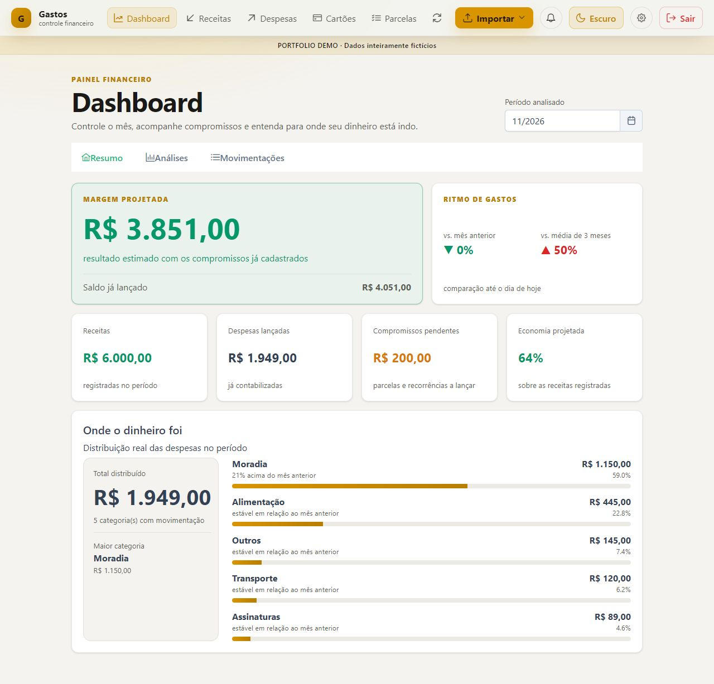
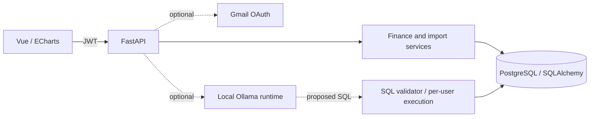

# FinançasLM

[](https://github.com/Rafael-T-Melo10/financaslm-demo/actions/workflows/ci.yml)

**A personal-finance application with authenticated APIs, document imports and user-scoped SQL analysis.**

Track income, expenses, installments and recurring commitments in a Vue dashboard backed by a relational database. The code also includes Gmail import and an optional local language-model assistant, with both integrations disabled in the default demo.

**FastAPI · SQLAlchemy / Alembic · PostgreSQL · Vue 3 · PrimeVue · ECharts**

This portfolio edition contains only fictional records, a new Git history and dedicated demo configuration. No personal financial documents, academic evaluation datasets, credentials or original databases are included. The Portuguese UI retains its original **Gastos** branding.



## Engineering highlights

- JWT authentication and password hashing; authenticated CRUD and ownership checks.
- Income, expenses, credit cards, installments, recurring expenses, budgets and CSV exports.
- PDF parsing and an import-review workflow; Gmail OAuth support is available in the code and disabled by default.
- Versioned database migrations and reconciled reporting views.
- Optional read-only text-to-SQL: query allowlists, schema-qualified query rejection, row limits and per-user execution scope. SQL isolation is tested with SQLite and PostgreSQL.
- Explicit assistant status when the runtime is disabled or unavailable. No model is bundled and no accuracy claim is made.

## Run locally

Requirements: **Python 3.12**, **Node.js 22** and npm. In the repository root:

```bash
python -m venv .venv
# Windows PowerShell: .venv\Scripts\Activate.ps1
# macOS/Linux: source .venv/bin/activate
python -m pip install -r backend/requirements-dev.txt
python scripts/configure_demo.py
python scripts/local_demo.py
```

In a second terminal:

```bash
cd frontend
npm ci
npm run demo
```

Open **http://127.0.0.1:3012**. Accounts: `alex@example.com` and `sam@example.com`. Their generated password is `DEMO_PASSWORD` in the private root `.env`.

The backend runs at `127.0.0.1:8012`; interactive API documentation is at **http://127.0.0.1:8012/docs**. The frontend proxy keeps browser requests on the same origin. The launcher uses only `.demo/portfolio.sqlite3`, runs Alembic migrations and seeds the fictional accounts without resetting existing data.

### A five-minute walkthrough

1. Sign in as Alex and inspect the current month's dashboard, income and expenses.
2. Open the credit card, installment and recurring-expense screens.
3. Import `samples/fictional-pay-statement.pdf` using **Importar → Upload manual → Contracheque**. It is a synthetic parser fixture, not a real payroll document.
4. Sign out and sign in as Sam: Alex's records should not appear.
5. Open **Assistente** to see the explicit disabled status. No Ollama installation is needed for the default demo.

### PostgreSQL with Docker Compose

```bash
python scripts/configure_demo.py  # once; preserves an existing .env
docker compose up --build
```

The separate `financaslm-portfolio-demo` project uses PostgreSQL 16, a dedicated volume, an API on localhost:8012 and Nginx on localhost:3012. Native PostgreSQL 18 was used for local security-test validation; Docker runtime validation is not claimed.

## Architecture



The assistant's SQL is validated before execution. Its database path is read-only and scoped to the authenticated user. These controls do not establish language-model answer accuracy.

See [API notes](docs/API.md), [Portuguese demo guide](docs/DEMO.pt-BR.md) and [validation](docs/VALIDATION.md).

## Tests and build

```bash
cd backend
python -m pytest -q
cd ../frontend
npm run build
```

The backend suite covers authentication, ownership, CRUD, parsing, import deduplication, recurring expenses, reporting and assistant failure paths. External integrations are mocked. PostgreSQL-specific SQL-isolation tests require explicit `TEST_POSTGRES_*` variables and the disposable database name `financaslm_validacao`; the workflow migrates that database before running them.

The frontend includes an end-to-end script under `frontend/tests/`; browser installation and running demo servers are required. See the validation document for what was actually executed.

## Boundaries

Gmail, WhatsApp and the assistant are disabled by default. Live provider calls and model inference are not part of the verified demo. OCR for scanned PDFs additionally requires Tesseract and the appropriate language data; the supplied PDF contains selectable text. This is a local portfolio demo, not a production financial service. Review dependency updates, token storage, rate limiting, upload limits, monitoring and deployment settings before handling real data.

Existing [MIT license](LICENSE) retained.
